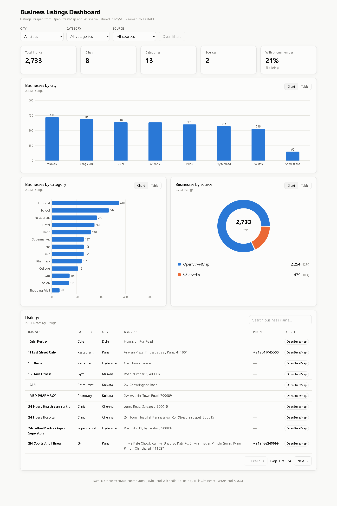

# Business Listings Dashboard

A full-stack, data-driven dashboard that **scrapes 2,733 real business listings**,
stores them in **MySQL**, serves aggregated data through a **FastAPI** REST API,
and visualises it in a **React** dashboard.

> Internship assignment for **Python Development Intern**, Honeybee Digital
> **Author:** Pavan P · somasaicheviti@gmail.com



---

## Highlights

| | |
|---|---|
| **Data** | 2,733 listings · 8 cities · 13 categories · 2 sources (OpenStreetMap, Wikipedia) · 583 with phone numbers |
| **Scraping** | Overpass API (OSM) + MediaWiki API with BeautifulSoup HTML parsing · polite client (User-Agent, rate limit, retries, caching) |
| **Cleaning** | city aliases (Bangalore → Bengaluru), phones → `+91…`, text cleanup, de-duplication |
| **API** | bulk insert (validated, idempotent, one transaction) · city / category / source counts with filters · summary · paginated listings · Swagger docs |
| **Dashboard** | stat cards, bar and donut charts (Recharts), click-to-filter, chart/table toggle, searchable table, dark mode, mobile layout |
| **Quality** | layered backend, typed schemas, 33 automated tests, linted frontend, step-by-step docs |

---

## Tech stack

| Layer | Technology |
|---|---|
| Frontend | **React 19**, Vite, **Recharts**, plain CSS (design tokens, dark mode) |
| Backend API | **FastAPI**, Pydantic 2, SQLAlchemy 2, Uvicorn |
| Database | **MySQL 8.4** (InnoDB, utf8mb4) via PyMySQL |
| Scraping | Python `requests`, **BeautifulSoup4** + lxml, Overpass API, MediaWiki API |
| Tests | pytest, FastAPI TestClient |
| Tooling | Docker Compose (MySQL), Git |

---

## Architecture

```
OpenStreetMap (Overpass API) ─┐
Wikipedia (API + HTML)       ─┤─► scraper/ ── clean ──► POST /api/listings/bulk
                              │                              │
                              │                     backend/ (FastAPI + SQLAlchemy)
                              │                              │
                              │                         MySQL listing_master
                              │                              │
              frontend/ (React + Recharts) ◄── GET /api/dashboard/*
```

---

## Repository layout

```
├── backend/          FastAPI app (routers → crud → models), tests, requirements
├── frontend/         React + Vite dashboard
├── scraper/          scrapers, cleaner, uploader, scraped data, tests
├── database/         schema.sql and listings_dump.sql
├── docs/             step-by-step documentation (00 → 11)
└── docker-compose.yml   MySQL 8.4 for local development
```

---

## Setup

### Prerequisites
Python 3.11+ · Node.js 20+ · MySQL 8 (local install **or** Docker Desktop)

### 1. Clone
```bash
git clone https://github.com/somasaic/Business_Listing_Dashboard.git
cd Business_Listing_Dashboard
```

### 2. Start MySQL
**Docker (easiest):**
```bash
docker compose up -d        # creates DB business_listings + table listing_master
```
**or a local MySQL:**
```sql
-- in the mysql client / Workbench
SOURCE database/schema.sql;
CREATE USER 'listings_user'@'localhost' IDENTIFIED BY 'listings_pass';
GRANT ALL PRIVILEGES ON business_listings.* TO 'listings_user'@'localhost';
```

### 3. Backend
```bash
python -m venv .venv
.venv\Scripts\activate                # Windows   (macOS/Linux: source .venv/bin/activate)
pip install -r backend/requirements.txt -r scraper/requirements.txt

cd backend
cp .env.example .env                  # edit if your MySQL credentials differ
uvicorn app.main:app --reload         # http://localhost:8000/docs
```

### 4. Load the data (pick one)
```bash
# A) Use the already-scraped, cleaned data → through the bulk-insert API
python -m scraper.uploader

# B) Re-scrape everything, clean and upload (~10 min, uses polite delays)
python -m scraper.run_pipeline --upload

# C) Import the SQL dump directly
mysql -u root -p < database/listings_dump.sql
#   Docker: docker exec -i listings-mysql mysql -uroot -proot123 < database/listings_dump.sql
```
(Run A/B from the project root with the virtualenv active and the API running.)

### 5. Frontend
```bash
cd frontend
cp .env.example .env                  # VITE_API_URL=http://localhost:8000
npm install
npm run dev                           # http://localhost:5173
```

### 6. Tests
```bash
cd backend && python -m pytest -q                 # 15 API tests (in-memory SQLite, no MySQL needed)
cd .. && python -m pytest scraper/tests -q        # 18 scraper / cleaning tests
```

---

## API reference

Interactive docs: **http://localhost:8000/docs**

| Method | Endpoint | Description |
|---|---|---|
| `POST` | `/api/listings/bulk` | Bulk insert up to 5,000 listings → `201 {received, inserted, duplicates_skipped}` |
| `GET` | `/api/dashboard/city-count` | City-wise count. Optional `category`, `source`, `limit` |
| `GET` | `/api/dashboard/category-count` | Category-wise count. Optional `city`, `source`, `limit` |
| `GET` | `/api/dashboard/source-count` | Source-wise count. Optional `city`, `category`, `limit` |
| `GET` | `/api/dashboard/summary` | Totals: listings, cities, categories, sources, with phone |
| `GET` | `/api/listings` | Paginated rows: `page`, `page_size` (≤100), `city`, `category`, `source`, `search` |
| `GET` | `/api/health` | API + database health |

Example:
```bash
curl "http://localhost:8000/api/dashboard/category-count?city=Mumbai&limit=3"
```
```json
{"dimension":"category","total":434,"items":[
  {"label":"Hospital","count":66},{"label":"Bank","count":54},{"label":"School","count":46}]}
```

---

## Database

Table **`listing_master`**: `id` (PK), `business_name`, `category`, `city`,
`address`, `phone`, `source`, `created_at`, plus `listing_hash` (SHA-256 of
normalised name + city + address, **UNIQUE**) for duplicate protection.
Indexes on `city`, `category` and `source` serve the `GROUP BY` queries.
See [docs/03-database-design.md](docs/03-database-design.md).

---

## Scraping approach

* **Why not Google Maps / Justdial / Sulekha?** Their terms of service forbid
  automated scraping, and the brief says to respect ToS. I chose two **open,
  scraping-friendly sources** instead:
  1. **OpenStreetMap** (ODbL): one Overpass QL query per city for 12 business
     categories, keeping only places with a name **and** a street address.
  2. **Wikipedia** (CC BY-SA): the MediaWiki API lists articles in categories
     like *Hospitals in Chennai*. Each article's HTML is parsed with
     **BeautifulSoup** to extract the infobox address and phone.
* The polite HTTP client sends an identifying User-Agent, waits between requests,
  retries with exponential back-off, falls back across mirrors, and caches raw responses.
* The cleaner normalises cities and phones, fixes text noise, and removes duplicates.

Details: [docs/04-web-scraping.md](docs/04-web-scraping.md) · [docs/05-data-cleaning.md](docs/05-data-cleaning.md)

---

## Challenges faced

1. **Respecting terms of service.** The suggested sites (Google Maps, Justdial)
   prohibit scraping and use bot protection. I researched alternatives and
   picked OpenStreetMap and Wikipedia, which allow programmatic access and still
   provide real business data.
2. **Anonymous requests rejected.** The main Overpass server answered
   *406 Not Acceptable* to a request without a User-Agent. I added an
   identifying User-Agent, retries with back-off, and fallback mirrors.
3. **Inconsistent, messy data.** The same city appears as "Bangalore" and
   "Bengaluru". Phones come in a dozen formats ("080-…", "+91 …", several
   numbers separated by ";"). Addresses contain citation marks, " , " and ",,".
   I solved this with a dedicated cleaning step backed by unit tests.
4. **Duplicates.** A composite UNIQUE key on (name, city, address) exceeds
   InnoDB's 3,072-byte index limit with utf8mb4. I used a SHA-256 hash of the
   normalised values with a UNIQUE index instead, which also catches
   "same business, different formatting".
5. **Missing phone numbers.** Only about 21% of open-data listings include a
   phone. I kept `phone` nullable (the brief says "if available"), stored only
   valid numbers, and show the coverage as a stat card instead of inventing data.
6. **Balanced charts.** Without limits, restaurants in Mumbai alone would
   dominate. I capped each (city, category) query at 30 results.
7. **Dashboard UX.** Cross-filtering without losing context: each chart is
   filtered by the *other* dimensions, so the selected bar stays visible and
   highlighted. Stale responses are ignored when filters change quickly.

---

## Documentation

Every step (what, why, and the concepts used) is documented in **[docs/](docs/README.md)**:
assignment analysis → setup → structure → database → scraping → cleaning →
FastAPI → data loading → React → testing → dump → submission.

---

## Data attribution
Map data © OpenStreetMap contributors, available under the
[Open Database License](https://www.openstreetmap.org/copyright).
Wikipedia content under [CC BY-SA 4.0](https://creativecommons.org/licenses/by-sa/4.0/).
