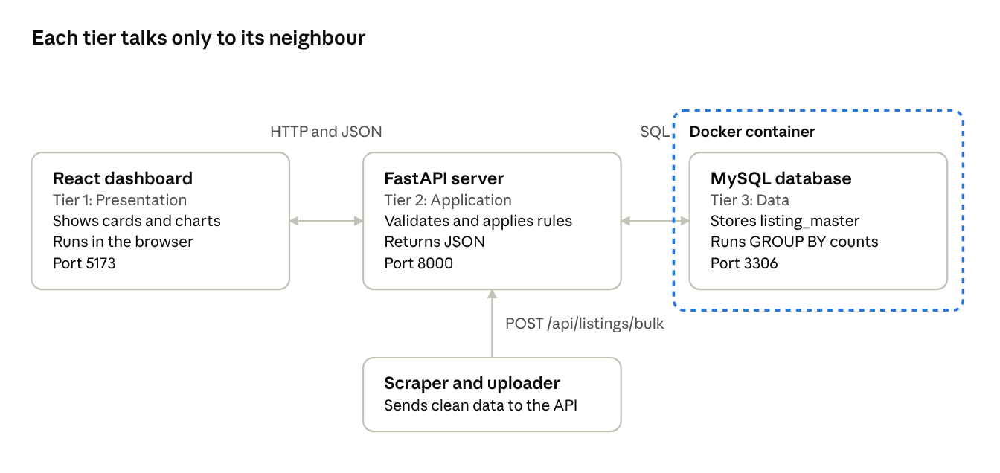
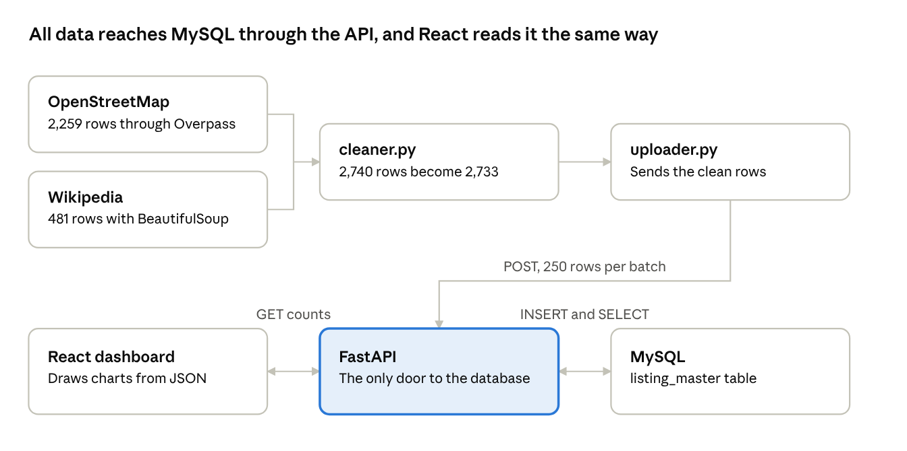
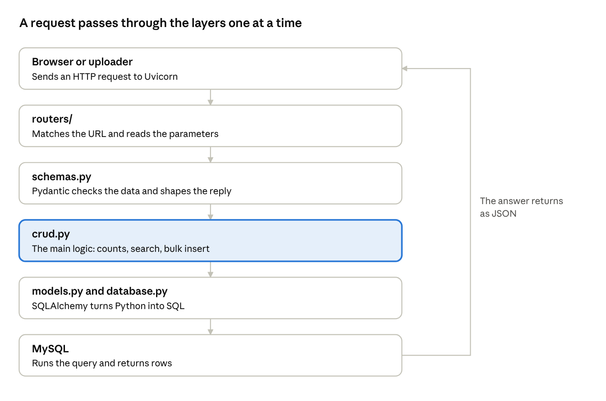
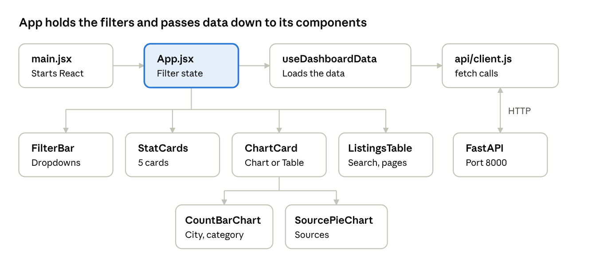
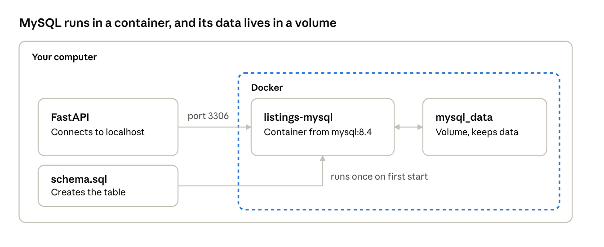
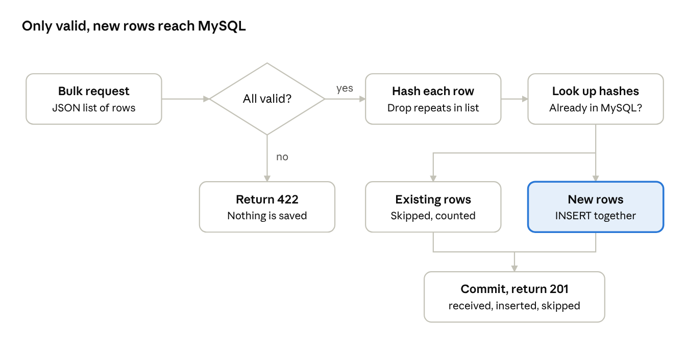
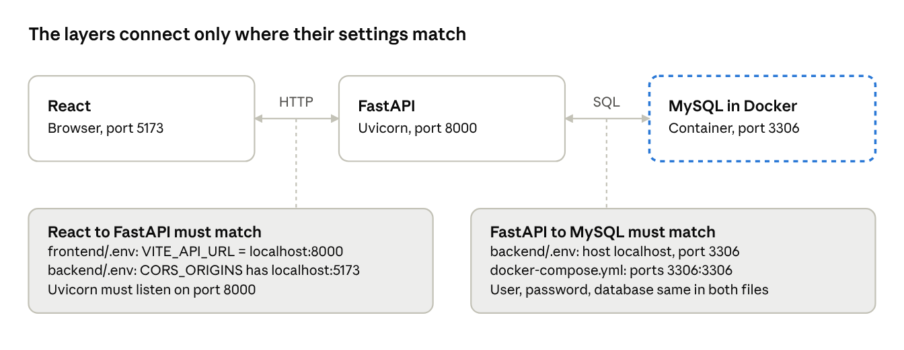
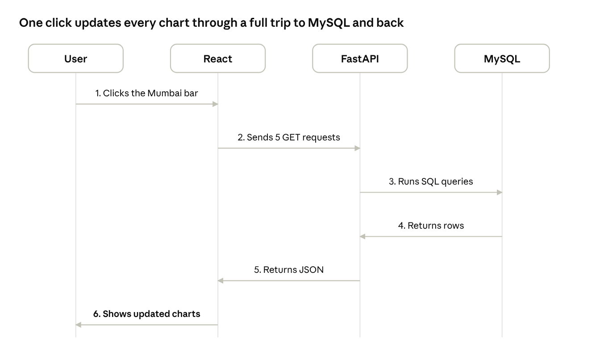

# Business Listings Dashboard: Interview Prep

## 1. How to use this guide

Study in order, with the project open beside this guide. By 12:45 PM you should be able to explain the project, run it, and answer the common questions truthfully. The company's own email says what they want: explain your approach, know the tools, revise the fundamentals, and answer honestly.

| Priority | Study | Time |
| --- | --- | --- |
| 1 | Sections 2 to 5: the story, requirements, architecture and reasons | 60 min |
| 2 | Section 18: run the project yourself | 30 min |
| 3 | Sections 9 to 14: how each part works, then 16 and 17: main logic and integration | 2 hours |
| 4 | Section 6 and 7: folders, files and packages | 45 min |
| 5 | Sections 19 to 21 and 24: stories, questions, honesty and AI use | 60 min |
| 6 | Sections 22 and 23: read again just before the interview | 15 min |

Three rules for the interview:

- Say answers in your own words. Memorised lines fall apart at the first follow-up question.
- Open the real file while studying a concept, so you can find it during a screen share.
- If you do not know something, say so. Section 21 shows how.

## 2. The project in 60 seconds

The project collects real business data, stores it in a database, serves it through an API, and shows it as charts in a website. Use this as your opening answer to "Tell me about your project":

> "This is a Business Listings Dashboard. It collected 2,733 real business listings from OpenStreetMap and Wikipedia, across 8 Indian cities and 13 categories. Python scripts collect and clean the data. FastAPI saves it into a MySQL table called listing\_master, and provides APIs for city, category and source counts. A React dashboard shows those counts as bar and pie charts, and you can click a bar to filter everything. MySQL runs in Docker, so setup is one command. The project was built with AI help and a friend's help, and I studied each part so I can explain how it works."

A simple way to remember it is a restaurant:

| Project part | Restaurant comparison | Job |
| --- | --- | --- |
| Scraper | Buying vegetables from the market | Collects raw data |
| Cleaner | Washing and cutting them | Fixes messy data |
| MySQL | The storeroom | Keeps data safely |
| FastAPI | The waiter | Carries requests and answers |
| React | The dining table and menu | Shows data to the user |
| Docker | A ready-made portable kitchen | Runs MySQL the same way anywhere |

## 3. What the company asked for and what was built

Every requirement in the assignment is covered, and the mandatory stack of React, FastAPI and MySQL is used. The project also adds extras such as tests, filters and Docker.

| Part | Company asked for | What was built | Where to show it |
| --- | --- | --- | --- |
| 1. Scraping | 500+ listings with name, category, city, address, phone if available, and source | 2,733 listings from 2 sources | `scraper/` |
| 2. Database | MySQL table `listing_master` with 8 given columns | Same table, plus `listing_hash` to stop duplicates | `database/schema.sql` |
| 3. API | Bulk insert, plus city, category and source counts | All 4, plus summary, listings and health APIs | `backend/app/routers/` |
| 4. Dashboard | Bar and pie charts, clean and minimal | 2 bar charts, 1 donut (pie) chart, cards, filters and table | `frontend/src/` |
| Submission | GitHub repo with separate frontend and backend folders | Done | Repo root |
| Submission | 3 to 5 minute demo video | Recorded separately using the script in \`docs/\` | Drive folder |
| Submission | `.sql` dump | 2,733 rows, restore tested | `database/listings_dump.sql` |
| Submission | README with setup, tech stack and challenges | Done | `README.md` |

**Extras beyond the brief, and why they help:**

- `listing_hash`: blocks duplicates, even when the bulk API is called twice.
- Filters on the count APIs: the charts can narrow to one city.
- 33 automated tests: they check that changes do not break anything.
- Docker: anyone can start MySQL with one command.

## 4. Big picture: architecture

The project uses a three-tier architecture: React shows data, FastAPI handles logic, and MySQL stores data. Each tier talks only to the one next to it. So the browser never touches the database directly, and any tier can be changed without rewriting the others.



The scraper is not one of the three tiers. It is a separate program that feeds the system through the same API.

| Tier | Technology | Job | If it were removed |
| --- | --- | --- | --- |
| Presentation | React | What the user sees | Data exists, but no one can view it easily |
| Application | FastAPI | Rules and validation | The website could not reach the data safely |
| Data | MySQL | Permanent storage | All data is lost on restart |

**Why three tiers?** Each part can be built, tested and replaced separately. The API can serve a mobile app later without changing the database. The browser also never sees database passwords.



The scraper never writes directly to MySQL. FastAPI is the single gateway, so every row passes the same validation and duplicate check.

## 5. Why this approach, and why not something else

The company fixed React, FastAPI and MySQL as mandatory. The other choices follow one idea: use legal data, keep each part separate, and make setup easy.

| Decision | Why this | Why not the alternative |
| --- | --- | --- |
| OpenStreetMap and Wikipedia | Open licences, and they allow automated access | Google Maps and Justdial restrict scraping in their terms and block bots |
| Overpass API for OSM | Returns clean JSON by city and category | Scraping map web pages would be slower and fragile |
| BeautifulSoup for Wikipedia | Infobox data sits inside HTML tables | No need for Selenium, because no browser actions are required |
| Separate cleaning step | Raw data is messy, so it is fixed in one tested place | Cleaning inside each scraper would repeat code |
| FastAPI (mandatory) | Fast to build, validates data, creates Swagger docs automatically | Flask needs more manual validation; Django is heavy for this size |
| MySQL (mandatory) | Data has fixed columns, and `GROUP BY` counts are easy | MongoDB suits flexible documents, which is not needed here |
| SQLAlchemy | Python code instead of raw SQL strings, and safer queries | Raw SQL is more error-prone to write and maintain |
| API between scraper and DB | All validation and duplicate checks live in one place | If the scraper wrote directly, those rules would exist twice |
| React (mandatory) with Recharts | Reusable components, and charts built for React | Chart.js and ApexCharts also work; Recharts fits React components naturally |
| Docker for MySQL | Same version everywhere, no manual install | A local MySQL install differs on each computer |

### Why not just Excel or a data visualisation tool?

Excel, Power BI or Tableau could draw these charts from a CSV file. But the assignment tests full-stack development, not only charts.

- **Automation:** new data can flow through the scraper, API and database without manual work.
- **Live data:** the dashboard reads the database through APIs each time, so it is never an old copy.
- **Multiple users:** a website can be opened by anyone with the link, with no extra software.
- **Reuse:** other apps can call the same API.
- **Mandatory stack:** the company specifically asked for React, FastAPI and MySQL.

> "Excel is great for one person analysing a fixed file. This project is a complete system: data comes in automatically, it is stored safely, and any screen can read it through an API."

## 6. Folder structure: every file and its purpose

The repo has one folder per job, so a change in one part rarely affects another. The company also asked for separate frontend and backend folders.

```text
Business_Listing_Dashboard/
├── scraper/            collects and cleans data, then uploads it
├── backend/            FastAPI server
├── frontend/           React dashboard
├── database/           SQL table script and full data dump
├── docs/               step-by-step documentation
├── docker-compose.yml  starts MySQL
├── README.md           main project guide
└── .gitignore          files Git must not upload
```

### scraper/ (the data pipeline)

| File | Purpose | When it acts |
| --- | --- | --- |
| `config.py` | Cities, categories, URLs and limits in one place | Read by every scraper file |
| `http_client.py` | `PoliteClient`: sends requests with delay and retries | Every web request |
| `osm_scraper.py` | Gets OpenStreetMap listings through Overpass | Step 1: 2,259 listings |
| `wikipedia_scraper.py` | Lists Wikipedia pages and reads their infobox tables | Step 1: 481 listings |
| `cleaner.py` | Fixes text, cities and phones, removes duplicates | Step 2 |
| `uploader.py` | Sends clean data to the API in batches of 250 | Step 3 |
| `run_pipeline.py` | Runs all the steps with one command | Whole pipeline |
| `requirements.txt` | Python packages for the scraper | Install time |
| `data/` | Saved JSON and CSV output files | Input for cleaner and uploader |
| `tests/test_cleaner.py` | 18 tests for cleaning rules | When testing |

### backend/ (the API server)

| File | Purpose | When it acts |
| --- | --- | --- |
| `app/main.py` | Creates the FastAPI app, CORS, error handler, health API | Server start |
| `app/config.py` | Reads settings from `.env` | Server start |
| `app/database.py` | Connects to MySQL and provides `get_db` | Every request |
| `app/models.py` | Python class `Listing` that maps to the table | Every database action |
| `app/schemas.py` | Pydantic rules for incoming and outgoing JSON | Every request and response |
| `app/crud.py` | All database logic: insert, counts, search | Called by routers |
| `app/routers/listings.py` | `POST /bulk` and `GET /api/listings` | API call |
| `app/routers/dashboard.py` | Summary and the 3 count APIs | Dashboard loading |
| `tests/conftest.py` | Test setup with a temporary database | When testing |
| `tests/test_api.py` | 15 API tests | When testing |
| `.env.example` | Sample settings to copy into `.env` | Setup |
| `requirements.txt`, `pytest.ini` | Package list and test settings | Setup and testing |

### frontend/ (the website)

| File | Purpose | When it acts |
| --- | --- | --- |
| `index.html` | The single page; React loads inside it | Browser opens site |
| `src/main.jsx` | Starts React and renders `App` | Page load |
| `src/App.jsx` | Main page layout and filter state | Always on screen |
| `src/api/client.js` | All `fetch` calls to the backend | Each data request |
| `src/hooks/useDashboardData.js` | Loads chart data when filters change | Page load, filter change |
| `src/hooks/useMediaQuery.js` | Detects small screens | Screen resize |
| `src/components/StatCards.jsx` | 5 summary cards | Dashboard |
| `src/components/FilterBar.jsx` | City, category and source dropdowns | Dashboard |
| `src/components/ChartCard.jsx` | Chart wrapper with Chart/Table toggle | Around each chart |
| `src/components/CountBarChart.jsx` | Clickable bar chart | City and category charts |
| `src/components/SourcePieChart.jsx` | Donut chart for sources | Source chart |
| `src/components/ChartTooltip.jsx` | Hover box on charts | Mouse hover |
| `src/components/ListingsTable.jsx` | Searchable table with pages | Bottom of dashboard |
| `src/index.css` | All styles, including dark mode | Page load |
| `vite.config.js`, `package.json`, `package-lock.json` | Build setup and package list | Install and build |
| `.env.example`, `.oxlintrc.json` | Sample API URL and lint rules | Setup and checks |

### database/, docs/ and root files

| File | Purpose |
| --- | --- |
| `database/schema.sql` | Creates the database and `listing_master` (structure only) |
| `database/listings_dump.sql` | Full backup: structure plus 2,733 rows |
| `docs/` | Step-by-step guides 00 to 11, plus setup and running guides |
| `docker-compose.yml` | Defines the MySQL container |
| `README.md` | Setup, tech stack, APIs, challenges |
| `.gitignore` | Keeps secrets (`.env`), `node_modules` and `.venv` out of GitHub |

The `__init__.py` files tell Python that a folder is a package, so imports such as `from . import config` work.

## 7. Packages: what each one does here

Packages are ready-made code from other developers. Python packages are listed in `requirements.txt` and installed with `pip`. JavaScript packages are listed in `package.json` and installed with `npm`.

### Python packages

| Package | What it is | Use in this project |
| --- | --- | --- |
| `requests` | Sends HTTP requests | Calls Overpass, Wikipedia and the upload API |
| `beautifulsoup4` | Reads HTML | Finds the Wikipedia infobox table |
| `lxml` | Fast HTML parser | The engine BeautifulSoup uses |
| `fastapi` | Web API framework | Builds all the API endpoints |
| `uvicorn[standard]` | Server program | Runs the FastAPI app |
| `SQLAlchemy` | ORM and database toolkit | Writes queries using Python |
| `PyMySQL` | MySQL driver | Connects Python to MySQL |
| `cryptography` | Security library | Needed for MySQL 8 password login |
| `python-dotenv` | Reads `.env` files | Loads database settings |
| `pytest` | Test framework | Runs the automated tests |
| `httpx` | HTTP client | Needed by FastAPI's `TestClient` |

Pydantic is also used through `schemas.py`. It installs automatically with FastAPI.

### Python built-in modules

| Module | Use in this project |
| --- | --- |
| `re` | Regular expressions for cleaning text |
| `json` | Reads and writes JSON files |
| `csv` | Writes the clean CSV file |
| `hashlib` | Creates the SHA-256 hash for duplicates |
| `logging` | Prints progress and errors |
| `argparse` | Reads command options such as `--upload` |
| `time` | Waits between requests |
| `pathlib` | Handles file paths |

### JavaScript packages

| Package | What it is | Use in this project |
| --- | --- | --- |
| `react`, `react-dom` | UI library | Builds and displays components |
| `recharts` | React chart library | Bar and donut charts |
| `vite` | Dev server and build tool | Runs and builds the site |
| `@vitejs/plugin-react` | Vite add-on | Lets Vite understand JSX |
| `oxlint` | Code checker | Finds code problems |
| `@types/react`, `@types/react-dom` | Type hints | Better editor suggestions |

### Key words

- **pip:** Python's package installer.
- **npm:** JavaScript's package installer.
- **Virtual environment (`.venv`):** a private package folder for one project, so projects do not clash.
- **Pinned versions (`fastapi==0.162.0`):** everyone installs the same version, so the project behaves the same.

## 8. Python fundamentals used in this project

These are the Python basics most likely to come up, each tied to real code from the project. This is a Python role, so learn this section well.

| Concept | Simple meaning | Example from the project |
| --- | --- | --- |
| List | Ordered collection | `listings = []` |
| Dictionary | Key and value pairs | `{"city": "Mumbai"}` |
| Set | Unique values, fast lookup | `existing: set[str]` in `crud.py` |
| Tuple | Fixed collection | City box `(south, west, north, east)` |
| Function | Reusable block of code | `def clean_text(value):` |
| Class | Blueprint with data and methods | `class PoliteClient:` |
| Object | One thing made from a class | `client = PoliteClient(delay=2.0)` |
| Inheritance | A class reuses another class | `class ListingCreate(ListingBase)` |
| Module | One `.py` file | `cleaner.py` |
| Package | Folder of modules | `scraper/` |
| `try / except` | Handle errors without crashing | Falls back to the next Overpass mirror |
| List comprehension | One-line list building | `[row for row in rows if row]` |
| f-string | Puts values inside text | `f"Category:{category}"` |
| Type hint | Says the expected type | `def upload(api_base: str) -> dict:` |
| Decorator | Adds behaviour to a function | `@router.get("/city-count")` |
| Generator | Gives values one at a time using `yield` | `batches()` in `uploader.py` |
| Regex | Text pattern matching | `re.sub(r"\s+", " ", text)` |
| Context manager | Automatic cleanup using `with` | `with engine.connect() as conn:` |

**Common questions:**

- **List or set?** A list keeps order and allows duplicates. A set has unique values and checks membership faster.
- **What does `yield` do?** It returns one value and pauses, so the whole result is not built at once. Here it produces one batch at a time.
- **What is `self`?** It refers to the current object of a class.
- **What does `__init__` do?** It sets up a new object.
- **Why `if __name__ == "__main__":`?** That code runs only when the file is run directly, not when it is imported.
- **What is `async`?** It lets a program wait for slow work without stopping other tasks. This project's routes are normal `def` functions, and FastAPI runs them in a thread pool. Only the startup and error handlers use `async`.

## 9. Step 1: Web scraping

Web scraping means collecting data from websites using a program. This project collected 2,740 raw listings: 2,259 from OpenStreetMap and 481 from Wikipedia.

### Basic terms

- **HTTP:** the language browsers and servers use. A client sends a request and the server sends a response.
- **GET and POST:** GET asks for data. POST sends data.
- **API:** a defined way for programs to ask a server for data.
- **JSON:** a text format for data, using keys and values.
- **HTML:** the structure of a web page.
- **Terms of service:** a website's rules. Good scraping follows them.

### Source 1: OpenStreetMap (`osm_scraper.py`)

OpenStreetMap is a free, community-built map. Its Overpass API can search places using a small query language.

```text
nwr["amenity"="hospital"]["name"]["addr:street"](south,west,north,east);
out tags 30;
```

Read it like this:

- `nwr`: search all OSM item types (node, way, relation).
- `["amenity"="hospital"]`: only hospitals.
- `["name"]["addr:street"]`: must have a name and a street.
- `(south,west,north,east)`: a box around the city.
- `out tags 30`: return their details, at most 30.

The code loops through 8 cities and 12 categories. The limit of 30 per city and category keeps the data balanced.

### Source 2: Wikipedia (`wikipedia_scraper.py`)

1. The MediaWiki API lists articles in a category such as "Hospitals in Chennai".
2. For each article, the code downloads its HTML.
3. BeautifulSoup finds `table.infobox`, the summary box on the page.
4. It reads each table row and picks the address and phone values.

### Being polite (`http_client.py`)

| Feature | Why |
| --- | --- |
| User-Agent | Tells the server who is calling |
| Delay | 2 seconds for Overpass, 0.5 seconds for Wikipedia, so servers are not overloaded |
| Retry with back-off | On a temporary failure, it waits 2, 4, then 8 seconds, up to 3 attempts |
| Mirrors | If one Overpass server fails, it tries the next |
| Cache | Saves responses locally, so a re-run does not ask again |

**Likely questions:**

- **Is scraping legal?** It depends on the site's terms and the data. This project used sources with open licences and credits them in the README.
- **Why not Selenium?** Selenium controls a real browser for pages that need clicks or JavaScript. These sources provide JSON and simple HTML.
- **What if the website layout changes?** The selector may stop matching, so the parser would need updating. Using APIs reduces that risk.

## 10. Step 2: Data cleaning

Cleaning turns 2,740 messy rows into 2,733 consistent ones by removing 7 duplicates and fixing formats. Bad data gives wrong charts, so this step protects everything after it.

| Problem | Example before | After | How |
| --- | --- | --- | --- |
| Same city, different names | Bangalore | Bengaluru | `CITY_ALIASES` dictionary |
| Extra spaces and commas | `Wadala , Mumbai` | `Wadala, Mumbai` | Regex in `clean_text` |
| Double commas | `Pune,, Deccan` | `Pune, Deccan` | Regex |
| Citation marks | `Adyar[1]` | `Adyar` | Regex |
| Phone formats | `080-22223333` | `+918022223333` | `normalise_phone` |
| Several phones | `098450 12345; 9845012346` | `+919845012345` | Keeps the first valid number |
| Invalid phone | `12345` | Empty (NULL) | Never invented |
| Duplicate listing | Same name, city and address | One row | `listing_key` and a set |

**Regex** means a pattern for finding text. For example, `\s+` means one or more spaces, and `\D` means any character that is not a digit.

**E.164** is the international phone format: `+`, country code, then number.

**How duplicates are found:** the code makes a key from the name, city and address, in lower case with only letters and digits kept. If that key was already seen, the row is skipped. This catches `Cafe-Coffee-Day` and `cafe coffee day` as the same name.

**Results:**

| Measure | Value |
| --- | --- |
| Raw rows | 2,740 |
| Duplicates removed | 7 |
| Clean rows | 2,733 |
| Rows with address | 2,510 |
| Rows with phone | 583 (about 21%) |

**Why are only 21% of phones present?** Open data often has no phone number. The assignment says "if available", so missing phones stay empty instead of being made up.

## 11. Step 3: MySQL database

All data lives in one MySQL table, `listing_master`, with one row per business. MySQL is a relational database: it stores data in tables with rows and columns, and you talk to it using SQL.

| Column | Type | Rule | Purpose |
| --- | --- | --- | --- |
| `id` | INT UNSIGNED | Primary key, auto-increment | Unique row number |
| `business_name` | VARCHAR(255) | NOT NULL | Business name |
| `category` | VARCHAR(100) | NOT NULL, indexed | Hospital, Bank and so on |
| `city` | VARCHAR(100) | NOT NULL, indexed | City name |
| `address` | VARCHAR(500) | Can be NULL | Address |
| `phone` | VARCHAR(30) | Can be NULL | Phone number |
| `source` | VARCHAR(50) | NOT NULL, indexed | OpenStreetMap or Wikipedia |
| `listing_hash` | CHAR(64) | UNIQUE | Blocks duplicates |
| `created_at` | TIMESTAMP | Default current time | When the row was saved |

### Key concepts

- **Primary key:** uniquely identifies each row.
- **NULL:** no value. It is different from empty text or zero.
- **VARCHAR:** text of varying length, up to a limit. **CHAR(64)** always has 64 characters, which fits a SHA-256 hash.
- **Why is `phone` text, not a number?** It has a `+`, can start with 0, and nobody does maths on phone numbers.
- **Index:** like a book's index. It lets MySQL find rows without reading the whole table. It makes reads faster, but writes slightly slower and uses extra space.
- **Unique constraint:** MySQL refuses two rows with the same value.
- **utf8mb4:** a character set that stores all languages, including Indian scripts.
- **InnoDB:** the MySQL storage engine that supports transactions.
- **Transaction:** a group of changes that all succeed or all fail.
- **Normalization:** splitting data into related tables to avoid repetition. The assignment asked for a single table, so this project keeps one.

### What is `listing_hash`?

A hash turns any text into a fixed-length code. The same input always gives the same code. Here, SHA-256 hashes the cleaned name, city and address. A unique key directly on those long columns would exceed InnoDB's 3,072-byte index limit, so a 64-character hash is used instead.

### SQL to know

```sql
-- Rows per city (the city-count API)
SELECT city, COUNT(*) FROM listing_master
GROUP BY city ORDER BY COUNT(*) DESC;

-- Filter
SELECT * FROM listing_master WHERE city = 'Mumbai' LIMIT 10;

-- Search by part of a name
SELECT * FROM listing_master WHERE business_name LIKE '%Apollo%';

-- How many listings have a phone?
SELECT COUNT(phone) FROM listing_master;
```

- `COUNT(*)` counts all rows. `COUNT(phone)` skips NULL values.
- `WHERE` filters rows before grouping. `HAVING` filters after grouping.
- `GROUP BY` puts matching rows together so you can count them.
- A `JOIN` combines tables. This project has one table, so it needs none, but you should still know the idea.

### Dump and schema

- `schema.sql` holds the structure only.
- `listings_dump.sql` holds the structure and all 2,733 rows. It was made with `mysqldump`, and reloading it was tested.

The same table is described twice, as SQL in `schema.sql` and as a Python class in `models.py`. The class lets the code use the table through SQLAlchemy, an **ORM** (Object Relational Mapper): one Python object equals one table row.

## 12. Step 4: FastAPI backend

The backend is the only part that talks to MySQL, and it provides 7 endpoints. FastAPI is a Python framework for building APIs. It checks data using Python type hints and creates a Swagger test page automatically at `/docs`.



Routers stay thin and `crud.py` holds the logic. This is called **separation of concerns**: each file has one job, so bugs are easier to find.

### Basic terms

- **REST API:** a common style where each URL is a resource and HTTP methods say what to do.
- **Endpoint:** one URL and method, such as `GET /api/dashboard/city-count`.
- **Query parameter:** a filter in the URL, such as `?city=Mumbai`.
- **Request body:** JSON data sent with a POST.
- **Server:** Uvicorn runs the FastAPI app and listens on port 8000.

| Status code | Meaning | Used here |
| --- | --- | --- |
| 200 | OK | Successful GET |
| 201 | Created | Bulk insert worked |
| 422 | Invalid data | A row failed validation |
| 500 | Server error | An unexpected failure |
| 503 | Service unavailable | MySQL is down |

### All endpoints

| Method | URL | What it does | Asked by company? |
| --- | --- | --- | --- |
| POST | `/api/listings/bulk` | Saves up to 5,000 listings | Yes |
| GET | `/api/dashboard/city-count` | Listings per city | Yes |
| GET | `/api/dashboard/category-count` | Listings per category | Yes |
| GET | `/api/dashboard/source-count` | Listings per source | Yes |
| GET | `/api/dashboard/summary` | Totals for the cards | Extra |
| GET | `/api/listings` | Rows with paging and search | Extra |
| GET | `/api/health` | Checks API and database | Extra |

### Important concepts

- **Pydantic validation:** `schemas.py` defines the rules. For example, a name must have 1 to 255 characters. One bad row returns 422, and nothing is saved.
- **Dependency injection:** `Depends(get_db)` gives each request its own database session and closes it afterwards. The route does not manage connections.
- **`response_model`:** controls the shape of the JSON returned.
- **CORS:** browsers block a site from calling a different origin unless the server allows it. The dashboard runs on port 5173 and the API on port 8000, so `main.py` allows those frontend origins.
- **Connection pool:** keeps database connections ready for reuse, because opening a new one each time is slow.
- **Whitelist:** `GROUPABLE` lists the only columns allowed for grouping.
- **SQL injection:** an attack that sneaks SQL into user input. SQLAlchemy sends values as bound parameters, so input is treated as data, not code.
- **Pagination:** returns a page of rows at a time, using `LIMIT` and `OFFSET`.
- **Lifespan:** code that runs when the server starts and stops. Here it creates the table if missing and closes connections.

### How bulk insert works (`crud.py`)

1. Pydantic validates every row in the request.
2. The code makes a SHA-256 hash for each row and drops duplicates inside the request.
3. It asks MySQL which hashes already exist, 1,000 at a time.
4. It inserts only new rows, in one transaction.
5. It returns `received`, `inserted` and `duplicates_skipped`.

This makes the API **idempotent** for the data: calling it again with the same rows adds nothing. That is why the second run in the demo shows 0 inserted.

### How a count API works

`crud.count_by` builds a query like this. The optional filter is added only when it is given.

```sql
SELECT category, COUNT(id) FROM listing_master
WHERE city = 'Mumbai'
GROUP BY category
ORDER BY COUNT(id) DESC;
```

The answer comes back as JSON, ready for a chart:

```json
{"dimension": "category", "total": 434,
 "items": [{"label": "Hospital", "count": 66}]}
```

## 13. Step 5: React dashboard

The dashboard is a single-page website made of small reusable components. It gets all of its data from FastAPI, so it never touches MySQL directly. React is a JavaScript library for building user interfaces.

### Basic terms

- **Component:** a function that returns a part of the screen, such as `StatCards`.
- **JSX:** HTML-like code written inside JavaScript.
- **Props:** values a parent passes to a child, like function arguments.
- **State:** data a component remembers. When it changes, React updates the screen.
- **Hook:** a special React function. `useState` stores state, and `useEffect` runs code after rendering, such as loading data.
- **Custom hook:** your own reusable hook, such as `useDashboardData`.
- **Virtual DOM:** React works out what changed and updates only those parts of the page.
- **`fetch`:** the browser function that calls an API.
- **Promise:** a value that arrives later. `Promise.all` waits for several requests together.
- **Vite:** runs the local development server and builds the final site.

### How data reaches the screen

1. `App.jsx` stores the selected filters in state.
2. `useDashboardData(filters)` calls 4 APIs together through `api/client.js`.
3. The results are stored in state.
4. React passes the data as props to the cards and charts.
5. When a filter changes, the steps repeat.



Data flows down from `App` as props. `ListingsTable` is the one exception: it loads its own rows through `api/client.js`, because it has its own search and page number.

### Smart behaviour worth explaining

| Feature | How it works | Why |
| --- | --- | --- |
| Click to filter | Clicking a bar sets that filter; clicking it again clears it | Easy exploring |
| Cross filtering | Each chart ignores its own filter | The city chart keeps all cities, with the selected one highlighted |
| Ignoring old responses | `useEffect` cleanup sets `cancelled = true` | A slow old response cannot replace newer data |
| Debounced search | Waits 300 ms after typing stops | Avoids one API call per letter |
| Chart or Table toggle | `ChartCard` switches the view | Exact numbers, and easier access |
| Responsive layout | CSS breakpoints and `useMediaQuery` | Works on phones |
| Dark mode | CSS variables change with the system setting | Comfortable viewing |
| Error message | Shows a banner if the API is down | The user knows what went wrong |

**Why Recharts?** It provides charts as React components, such as `<BarChart>` and `<Pie>`. The assignment allowed Chart.js, Recharts or ApexCharts.

**Why a bar chart and a pie chart?** Bars compare many items, such as cities. A pie or donut shows parts of a whole, which suits the 2 sources: OpenStreetMap at 2,254 and Wikipedia at 479.

## 14. Step 6: Docker

Docker runs MySQL in an isolated box, so nobody has to install MySQL by hand. In this project only MySQL runs in Docker. FastAPI and React run directly on the computer during development.



If the container is removed, the data stays safe in the volume. It is deleted only by `docker compose down -v`.

| Term | Simple meaning | In this project |
| --- | --- | --- |
| Image | A ready-made package, like a recipe | `mysql:8.4` |
| Container | A running copy of an image | `listings-mysql` |
| Docker Compose | Starts containers from a YAML file | `docker-compose.yml` |
| Volume | Storage that survives container removal | `mysql_data` |
| Port mapping | Connects a computer port to a container port | `3306:3306` |
| Environment variable | A setting passed to the container | `MYSQL_DATABASE` |
| Health check | Tests whether the service is ready | `mysqladmin ping` |

### What `docker-compose.yml` does

- Downloads MySQL 8.4 and starts it as `listings-mysql`.
- Creates the `business_listings` database and the `listings_user` account.
- Opens port 3306, so FastAPI can connect from the computer.
- Stores data in the `mysql_data` volume.
- Runs `schema.sql` once on first start, which creates `listing_master`.
- Uses `utf8mb4`, so all languages save correctly.

**Docker or a virtual machine?** A VM runs a full operating system. A container shares the host's kernel, so it is lighter and starts faster.

**Do the passwords in the file matter?** They are local development values only. A real deployment would keep them in a secret store.

**Useful commands:**

```powershell
docker compose up -d     # start in the background
docker ps                # list running containers
docker compose down      # stop, and keep the data
docker compose down -v   # stop, and delete the data
```

## 15. Step 7: Testing and code quality

The project has 33 automated tests, 15 for the API and 18 for cleaning, and all of them passed when last run. Tests are code that checks other code, so a change that breaks something is noticed quickly.

| Tool or idea | Meaning | In this project |
| --- | --- | --- |
| `pytest` | Python test framework | Runs all tests |
| Fixture | Reusable test setup | `client` in `conftest.py` |
| `TestClient` | Calls the API without a real server | `test_api.py` |
| Parametrised test | One test run with many inputs | Phone format tests |
| In-memory SQLite | Temporary database in RAM | Lets API tests run without MySQL |
| Linter | Checks code for problems | `oxlint` for React |

**Unit test or integration test?** A unit test checks one small function, such as `normalise_phone`. An integration test checks parts working together, such as an API call that saves to a database.

**Other quality habits:**

- Separate layers, with each file doing one job.
- Type hints and validated schemas.
- Secrets kept out of Git through `.env` and `.gitignore`.
- Git history, a README and step-by-step docs.

**Commands:**

```powershell
cd backend; python -m pytest -q      # 15 tests
python -m pytest scraper/tests -q    # 18 tests, from project root
cd frontend; npm run lint; npm run build
```

## 16. Main code logic

Almost all the important logic sits in the database rules and 3 files: `crud.py`, `schemas.py` and `database.py`. Learn these first. Open each file while reading, because interviewers often ask you to walk through real code.

| Logic | File | Function | What to remember |
| --- | --- | --- | --- |
| Duplicate identity | `crud.py` | `compute_listing_hash` | Same cleaned name, city and address gives the same hash |
| Bulk insert | `crud.py` | `bulk_insert_listings` | Check first, insert only new rows, commit once |
| Chart counts | `crud.py` | `count_by` | `GROUP BY` with optional filters |
| Card totals | `crud.py` | `get_summary` | `COUNT` and `COUNT(DISTINCT ...)` |
| Search and pages | `crud.py` | `list_listings` | `LIKE`, `LIMIT` and `OFFSET` |
| Validation | `schemas.py` | `ListingBase` | Bad data stops before the database |
| Database session | `database.py` | `get_db` | One session per request, always closed |

### Database schema logic

Each rule in `database/schema.sql` exists for a reason.

| Rule | Applied to | Logic |
| --- | --- | --- |
| `PRIMARY KEY`, `AUTO_INCREMENT` | `id` | MySQL gives each row a unique number |
| `NOT NULL` | Name, category, city, source | Charts group by these, so they must exist |
| `NULL` allowed | Address, phone | The brief says phone is optional, and some sources have no address |
| `UNIQUE` | `listing_hash` | MySQL itself refuses a duplicate |
| `INDEX` | City, category, source | Makes filters and `GROUP BY` faster |
| `DEFAULT CURRENT_TIMESTAMP` | `created_at` | MySQL fills in the save time |
| `utf8mb4` | Whole table | Stores names in any language |
| `InnoDB` | Whole table | Supports transactions |

The table has no foreign keys because there is only one table, as the assignment required. A larger system could move cities and categories into their own tables.

**Duplicates are checked at 3 levels:**

1. `cleaner.py` removes duplicates in the scraped file.
2. `crud.py` skips rows already in the database.
3. The `UNIQUE` key in MySQL is the final guard.

### Logic 1: Creating the duplicate hash

```python
norm = lambda s: re.sub(r"[^a-z0-9]", "", (s or "").lower())
key = f"{norm(name)}|{norm(city)}|{norm(address)}"
return hashlib.sha256(key.encode("utf-8")).hexdigest()
```

1. `norm` makes text lower case and keeps only letters and digits.
2. The 3 values are joined with `|`.
3. SHA-256 turns that text into a 64-character code.

| Input | Key | Hash starts with |
| --- | --- | --- |
| Cafe  Coffee Day, Pune, FC Road | `cafecoffeeday\|pune\|fcroad` | `e0b633bd` |
| cafe-coffee-day, PUNE, F.C. Road | `cafecoffeeday\|pune\|fcroad` | `e0b633bd` |

The spelling style differs, but the hash is the same, so MySQL stores only one row.

### Logic 2: Bulk insert

```python
# 1. hash rows, drop repeats inside this request
for item in listings:
    row = item.model_dump()
    row["listing_hash"] = compute_listing_hash(...)
    unique_rows.setdefault(row["listing_hash"], row)

# 2. find hashes already in MySQL, 1,000 at a time
existing.update(db.scalars(
    select(Listing.listing_hash).where(Listing.listing_hash.in_(chunk))))

# 3. insert only new rows, in one transaction
new_rows = [row for h, row in unique_rows.items() if h not in existing]
if new_rows:
    db.execute(insert(Listing), new_rows)
db.commit()
```

- `model_dump()` turns a Pydantic object into a dictionary.
- `setdefault` keeps the first row for each hash.
- `in_(chunk)` becomes SQL `WHERE listing_hash IN (...)`.
- The chunks of 1,000 avoid one huge SQL statement.
- Checking a Python `set` for each hash is fast.
- `commit()` saves the work permanently.



A single invalid row rejects the whole request. A duplicate row is different: it is skipped and counted, while new rows are still saved.

### Logic 3: Count APIs

```python
GROUPABLE = {"city": Listing.city, "category": Listing.category, "source": Listing.source}

column = GROUPABLE[dimension]
count = func.count(Listing.id).label("count")
stmt = _apply_filters(select(column, count), city, category, source)
stmt = stmt.group_by(column).order_by(count.desc(), column.asc())
```

- One function serves all 3 count APIs, so the logic is not repeated.
- `dimension` picks the column from a fixed whitelist. User text never chooses a column.
- `_apply_filters` adds a `WHERE` only for filters that were sent.
- Results are sorted by highest count, then by name.
- `total` is calculated before `limit`, so percentages stay correct.

### Logic 4: Summary cards

```python
func.count(Listing.id)                      # all rows
func.count(func.distinct(Listing.city))     # unique cities
func.count(Listing.phone)                   # rows with a phone
```

`COUNT(column)` ignores NULL values, so counting `phone` gives the number of listings that have one. The dashboard calculates the percentage: 583 of 2,733 is about 21%.

### Logic 5: Search and pagination

```python
stmt = stmt.where(Listing.business_name.like(f"%{search}%"))
stmt.offset((page - 1) * page_size).limit(page_size)
pages = math.ceil(total / page_size)
```

With 2,733 rows and 10 per page, there are 274 pages. For page 3, `OFFSET` is (3 - 1) × 10 = 20, so MySQL skips 20 rows and returns the next 10. The `search` text is sent as a bound parameter, not pasted into the SQL, which prevents SQL injection.

### Logic 6: Validation with Pydantic

```python
Name = Annotated[str, StringConstraints(strip_whitespace=True, min_length=1, max_length=255)]

class ListingBase(BaseModel):
    business_name: Name
    address: str | None = Field(default=None, max_length=500)

    @field_validator("address", "phone", mode="before")
    @classmethod
    def blank_to_none(cls, value): ...
```

- Spaces are trimmed, and an empty name is rejected.
- `str | None` means the value can be missing.
- `blank_to_none` stores blank text as NULL.
- `BulkInsertRequest` allows 1 to 5,000 rows.
- FastAPI runs this before the route, so bad data never reaches `crud.py`.

### Logic 7: One database session per request

```python
def get_db():
    db = SessionLocal()
    try:
        yield db
    finally:
        db.close()
```

The code before `yield` runs when the request starts. The route uses the session while the function is paused. The `finally` block always closes it, even after an error, so connections do not leak.

### Logic 8: Filters in React

```javascript
const toggleFilter = (key) => (value) =>
  setFilters((f) => ({ ...f, [key]: f[key] === value ? '' : value }))
```

Clicking a new bar sets the filter, and clicking the same bar clears it. `...f` copies the other filters, because React state should be replaced, not changed in place.

## 17. Integration: how all the parts connect

The parts are separate programs, and they connect only through network addresses and matching settings. React calls FastAPI over HTTP, FastAPI calls MySQL over a database connection, and Docker exposes MySQL on port 3306.



| Connection | How they talk | Set in | Tool in the code |
| --- | --- | --- | --- |
| Uploader to FastAPI | HTTP POST with JSON | `API_BASE_URL` in `scraper/config.py` | `requests` |
| React to FastAPI | HTTP GET, JSON reply | `VITE_API_URL` in `frontend/.env` | `fetch` in `api/client.js` |
| FastAPI to browser | CORS permission | `CORS_ORIGINS` in `backend/.env` | `CORSMiddleware` |
| FastAPI to MySQL | MySQL connection on port 3306 | `MYSQL_*` in `backend/.env` | SQLAlchemy and PyMySQL |
| Computer to container | Port mapping | `ports` in `docker-compose.yml` | Docker |
| Docker to table | Runs a SQL file on first start | `volumes` in `docker-compose.yml` | `schema.sql` |

### How FastAPI finds MySQL

1. `config.py` loads `backend/.env`.
2. `URL.create` builds the connection address from those values.
3. `database.py` creates the engine, which manages the connection pool.
4. `get_db` opens a session for each request.

```text
mysql+pymysql://listings_user:<password>@localhost:3306/business_listings
     |    |          |             |          |     |          |
  database driver   user       password      host  port    database
```

FastAPI uses `localhost` because it runs on the computer, and Docker forwards port 3306 into the container.

### One field through every layer

The same name carries a value through the system. If you rename a field in one layer, you must rename it in the others.

| Layer | File | Where `business_name` appears |
| --- | --- | --- |
| Scraper | `osm_scraper.py` | Dictionary key |
| Upload | `uploader.py` | JSON field in the POST |
| Validation | `schemas.py` | Pydantic field |
| ORM | `models.py` | Python class attribute |
| Database | `schema.sql` | Table column |
| Reply | `schemas.py` | `ListingOut` JSON field |
| Screen | `ListingsTable.jsx` | `row.business_name` |

Charts work the same way. The API returns `label` and `count`, and Recharts reads those through `dataKey="label"` and `dataKey="count"`.

### Write path: how data gets saved

1. `uploader.py` reads `listings_clean.json` and splits it into batches of 250.
2. It POSTs each batch to `/api/listings/bulk`.
3. Pydantic validates the rows.
4. `crud.py` hashes them and removes duplicates.
5. SQLAlchemy sends the `INSERT` through PyMySQL.
6. Port 3306 carries it into the Docker container.
7. MySQL saves the rows in the `mysql_data` volume.

### Read path: how a chart gets data

1. React calls `/api/dashboard/category-count?city=Mumbai`.
2. The browser checks that CORS allows it.
3. The router reads `city` from the URL, and `Depends(get_db)` supplies a session.
4. `crud.count_by` builds the `GROUP BY` query.
5. MySQL returns rows through port 3306.
6. Pydantic shapes them into JSON.
7. React saves the JSON in state, and Recharts draws the bars.

### Start-up order

Start from the bottom layer: **Docker and MySQL, then FastAPI, then React.** Each layer needs the one below it.

FastAPI still starts if MySQL is down. It logs the error, and requests return 503 until MySQL is back. `pool_pre_ping` then replaces dead connections.

### What fails when a link breaks

| Broken link | What you see | Why |
| --- | --- | --- |
| Docker stopped | API returns 503 | FastAPI cannot reach port 3306 |
| Wrong `MYSQL_PASSWORD` | API returns 503 | MySQL refuses the login |
| FastAPI stopped | Dashboard red banner | `fetch` gets no reply |
| Wrong `VITE_API_URL` | Dashboard red banner | React calls the wrong address |
| Wrong `CORS_ORIGINS` | CORS error in browser console | The browser blocks the reply |
| Volume deleted with `down -v` | Empty dashboard after restart | The saved data is gone |
| Field renamed in one layer | 422 error or blank column | Layers no longer agree |

**Why swap the database in tests?** Setting `DATABASE_URL` points the same code to in-memory SQLite. This works because the code talks to SQLAlchemy, not directly to MySQL. It shows the benefit of loose coupling.

**Interview answer: "How do your parts integrate?"**

> "Each part runs separately. MySQL runs in Docker and is exposed on port 3306. FastAPI connects to it through SQLAlchemy using settings from a `.env` file. React calls FastAPI over HTTP and receives JSON, and CORS allows that. The scraper uses the same API to save data, so everything goes through one validated gateway."

## 18. Running the project from zero

The project runs in 3 terminals: Docker first, then the API, then the dashboard. Do this yourself at least once before the interview, because being able to run it is the strongest proof you understand it.

```powershell
# Terminal 1: start MySQL
docker compose up -d

# Terminal 1: first-time Python setup
python -m venv .venv
.\.venv\Scripts\Activate.ps1
pip install -r backend/requirements.txt -r scraper/requirements.txt
copy backend\.env.example backend\.env
copy frontend\.env.example frontend\.env

# Terminal 1: start the API (port 8000)
cd backend
uvicorn app.main:app --reload

# Terminal 2: load data (project root, venv active)
.\.venv\Scripts\Activate.ps1
python -m scraper.uploader

# Terminal 3: start the dashboard (port 5173)
cd frontend
npm install
npm run dev
```

| Check | Open | Expected |
| --- | --- | --- |
| API | `http://localhost:8000/api/health` | `"database":"connected"` |
| API test page | `http://localhost:8000/docs` | Swagger page |
| Data | `http://localhost:8000/api/dashboard/summary` | `"total_listings":2733` |
| Website | `http://localhost:5173` | Charts and table |

**Common problems:**

| Problem | Likely cause | Fix |
| --- | --- | --- |
| Red banner on dashboard | API is not running | Start Uvicorn |
| 503 from API | MySQL is not running | Start Docker Desktop, then `docker compose up -d` |
| Empty charts | No data loaded | Run `python -m scraper.uploader` |
| CORS error in browser | Wrong frontend address | Open `localhost:5173` |
| `uvicorn` not recognised | Virtual environment is off | Activate `.venv` |

### What happens during one dashboard click

This walkthrough is a favourite interview question, because it tests the whole system at once.



Clicking Mumbai saves `city=Mumbai` in React state. That triggers 5 requests: summary, city, category and source counts from the hook, plus one from the listings table. FastAPI validates each one, MySQL runs the query, and React redraws with the new JSON.

## 19. Project stories

These short stories explain the project's decisions, using the pattern problem, solution, result. Tell them as "in this project". Say "I" only for work you personally did.

### How the project was organised

The order followed the data, so each part had something real to work with.

1. Read the PDF and email, and list the requirements.
2. Set up the environment, with Python, Node and Docker MySQL.
3. Design the table.
4. Scrape the data, then clean it.
5. Build the FastAPI endpoints.
6. Load the data through the API.
7. Build the React dashboard.
8. Write tests, export the SQL dump, and write the README and docs.

### Story 1: Choosing legal data sources

- **Problem:** the suggested sites restrict automated scraping.
- **Solution:** use OpenStreetMap and Wikipedia, which have open licences.
- **Result:** 2,733 real listings, more than five times the 500 required, with sources credited.

### Story 2: The server that rejected requests

- **Problem:** the main Overpass server returned `406 Not Acceptable` to an anonymous request.
- **Solution:** add an identifying User-Agent, retries with back-off, and mirror servers.
- **Result:** the scraper finished all 8 cities.

### Story 3: Messy data

- **Problem:** city names differed, phones came in many formats, and addresses had stray commas.
- **Solution:** a separate cleaning step with 18 tests.
- **Result:** one spelling per city and one phone format.

### Story 4: Stopping duplicates

- **Problem:** a unique key on name, city and address exceeds MySQL's 3,072-byte index limit.
- **Solution:** store a 64-character SHA-256 hash and make it unique.
- **Result:** uploading all 2,733 rows a second time inserted 0 and skipped 2,733.

### Story 5: Missing phone numbers

- **Problem:** only about 21% of listings had a phone.
- **Solution:** keep `phone` optional, and show coverage as a stat card.
- **Result:** the data stays honest, because no numbers are invented.

### Story 6: Balanced charts

- **Problem:** without a limit, a few big categories and cities would dominate.
- **Solution:** cap OpenStreetMap results at 30 per city and category.
- **Result:** the charts compare cities and categories more fairly.

### Story 7: Filters that keep context

- **Problem:** filtering every chart by city would leave the city chart with one bar.
- **Solution:** each chart ignores its own filter.
- **Result:** the selected bar stays highlighted beside the others, and the rest of the dashboard updates.

## 20. Interview question bank

Practise these aloud. Cover the answer, say your own version, then check it.

### Project overview

| Question | Short answer |
| --- | --- |
| Explain your project. | Use the 60-second answer in section 2. |
| What is three-tier architecture? | Presentation (React), application (FastAPI) and data (MySQL) are kept separate. |
| Why separate frontend and backend? | Each can change alone, and other apps can reuse the API. |
| How much data do you have? | 2,733 listings, 8 cities, 13 categories, 2 sources. |
| What was the hardest part? | Getting legal data and cleaning it. Tell Story 1 or 3. |
| What would you improve? | See the improvements list below. |

### Scraping and cleaning

| Question | Short answer |
| --- | --- |
| Why not Google Maps? | Its terms restrict scraping, so open sources were used. |
| What does BeautifulSoup do? | It reads HTML so code can find tags and values. |
| Difference between API and scraping? | An API gives structured data on purpose. Scraping extracts it from pages. |
| How do you avoid overloading servers? | Delays, caching, and retries that wait longer each time. |
| How do you handle failures? | Retries, then the next mirror server. |
| How are duplicates removed? | A key from cleaned name, city and address, checked against a set. |

### Python and FastAPI

| Question | Short answer |
| --- | --- |
| Why FastAPI? | It is fast to build with, has automatic validation, and creates docs automatically. |
| What is Pydantic? | A library that validates data using Python types. |
| What is `Depends`? | It supplies what a route needs, here a database session. |
| What is Uvicorn? | The server that runs the FastAPI app. |
| GET or POST? | GET reads data. POST sends data to create something. |
| PUT or PATCH? | PUT replaces a resource. PATCH changes part of it. Neither is used here. |
| What is CORS? | A browser rule. The API must allow the frontend's origin. |
| What is 422? | The request data failed validation. |
| What does idempotent mean? | Repeating the action gives the same result. |
| Why one transaction? | The rows are saved together, or not at all. |
| Why not `SELECT *` for counts? | Counting with `GROUP BY` is far lighter than sending every row. |

### Database

| Question | Short answer |
| --- | --- |
| What is a primary key? | A unique identifier for each row. |
| What is an index? | A lookup structure that speeds up reads. |
| `WHERE` or `HAVING`? | `WHERE` filters rows before grouping. `HAVING` filters groups. |
| `DELETE`, `TRUNCATE` or `DROP`? | `DELETE` removes rows, `TRUNCATE` empties the table, `DROP` removes the table. |
| Inner or left join? | Inner keeps matching rows. Left keeps all left rows, plus matches. |
| SQL or NoSQL? | SQL suits fixed tables and relations. NoSQL suits flexible documents. |
| What is ACID? | Atomic, Consistent, Isolated, Durable: the safety rules of transactions. |
| What is an ORM? | Code that maps classes to tables. Here it is SQLAlchemy. |
| Why is `phone` a VARCHAR? | It holds a plus sign, and it is not used for maths. |

### React and JavaScript

| Question | Short answer |
| --- | --- |
| What is React? | A library for building UIs from components. |
| Props or state? | Props come from a parent. State belongs to the component. |
| What is `useEffect` for? | Running side effects after render, such as API calls. |
| What does the dependency array do? | The effect re-runs when those values change. |
| What is debouncing? | Waiting until typing stops before acting. |
| What is a key in a list? | A stable ID that helps React track items. |
| `let`, `const` or `var`? | `const` cannot be reassigned, `let` can, and `var` is the older style. |
| What does `async/await` do? | It lets you write code that waits for a Promise in a simple style. |
| Why Vite? | Fast dev server and simple builds. |

### Docker and Git

| Question | Short answer |
| --- | --- |
| Image or container? | An image is the package. A container is it running. |
| What does a volume do? | It keeps data when a container is removed. |
| Why only MySQL in Docker? | That removes the hardest install. API and frontend are easy to run directly. |
| `git pull` or `git fetch`? | Fetch downloads changes. Pull downloads and merges them. |
| Why `.gitignore`? | It keeps secrets and generated folders out of the repo. |
| Why is `.env` not committed? | It can hold passwords. |

### Improvements you can suggest

Knowing a project's limits shows real understanding.

- **Login:** the API has no authentication, so anyone with access could post data.
- **Scheduled scraping:** refresh the data automatically.
- **Better duplicates:** two listings with the same name in a city and no address count as one.
- **Faster search:** `LIKE '%text%'` cannot use a normal index, so full-text search would scale better.
- **Concurrent uploads:** two identical uploads at once could hit the unique key and return an error.
- **Deployment:** run the API and website in Docker too, then host them online.
- **More sources:** add more cities and improve phone coverage.

## 21. Honesty questions

Tell the truth about who built this: a friend built it using Claude, and you learned it afterwards. HR's email says "answer honestly", and an interviewer can quickly detect memorised answers with follow-up questions. Being upfront protects you far more than a story that collapses, or one that surfaces after you are hired.

| Question | Truthful answer |
| --- | --- |
| Did you build this yourself? | "No, not alone. A friend helped me build it using an AI assistant, Claude. I then set it up, studied each part, and can explain how it works." |
| Did you use AI? | "Yes. Claude was used heavily for the code. I focused on understanding it." |
| Which part did you personally do? | Name only what you truly did, such as running it, recording the demo, or any change you made. |
| Can you change this code now? | Answer based on what you actually tried. |

If your submission gave a different impression, raise it early yourself. For example: "Before we start, I should mention how this project was built." A clear statement like this is far better than being caught out.

### When you do not know an answer

Do not guess or invent details. Use one of these:

- "I am not sure about that yet. I would check the documentation, and I would like to learn it."
- "I know the basic idea, but not the details."
- "Let me open the file and walk through it."

### Questions about you

HR's email also mentions your strengths, areas you are improving, and willingness to learn. Prepare true answers:

- **Strength:** one real example from your studies or projects.
- **Area to improve:** for example, "I am still building hands-on backend experience by practising on this project."
- **Willingness to learn:** "In the last few days, I worked through a full-stack project from scraping to dashboard, and learned each layer."
- **Resume:** revise everything listed on your resume. This guide cannot cover it, because the resume was not part of the material.
- **Questions for them:** "What would an intern work on in the first month?" and "How does the team review code?"

## 22. Last-minute cheat sheet

Read this once before the interview.

**The flow:** Scrape, Clean, API, MySQL, then API to React charts.

| Number | Meaning |
| --- | --- |
| 2,740 to 2,733 | Raw rows to clean rows |
| 7 | Duplicates removed |
| 2,254 and 479 | Clean listings from OpenStreetMap and Wikipedia |
| 8 and 13 | Cities and categories |
| 583 | Listings with a phone (about 21%) |
| 2,510 | Listings with an address |
| 7 | API endpoints (4 required, 3 extra) |
| 33 | Automated tests (15 API, 18 cleaning) |
| 250 | Upload batch size |
| 5,000 | Maximum rows in one bulk request |
| 3306, 8000, 5173 | MySQL, API and dashboard ports |

**Top cities:** Mumbai 434, Bengaluru 415, Delhi 384, Chennai 383, Pune 362, Hyderabad 346, Kolkata 319, Ahmedabad 90.

**Top categories:** Hospital 410, School 349, Restaurant 277, Hotel 261, Bank 240.

**Terms in one line:**

- **Pydantic:** validates data.
- **SQLAlchemy:** Python access to the database.
- **Uvicorn:** runs the API.
- **`Depends`:** gives a route its database session.
- **CORS:** lets the frontend call the API.
- **Index:** speeds up reads.
- **`listing_hash`:** blocks duplicates.
- **`useState`:** remembers data.
- **`useEffect`:** loads data.
- **Docker volume:** keeps data safe.

**On the day:** start Docker, the API and the dashboard 15 minutes early. Keep `README.md`, `crud.py`, `schema.sql` and the dashboard open. Speak slowly, and answer honestly.

## 23. Quick run steps

Run the project with 3 terminals: MySQL, then the API, then the dashboard. Start Docker Desktop first. These commands assume the first-time setup is done, and `F:\Python_Assignment_Pavan` should be replaced with your own project folder.

### Terminal 1: Start MySQL

```powershell
cd F:\Python_Assignment_Pavan
docker compose up -d
docker ps
```

Wait until `listings-mysql` shows `(healthy)`.

### Terminal 2: Start the API

```powershell
cd F:\Python_Assignment_Pavan
.\.venv\Scripts\Activate.ps1
cd backend
uvicorn app.main:app --reload
```

Wait for `Application startup complete`.

### Terminal 3: Start the dashboard

```powershell
cd F:\Python_Assignment_Pavan\frontend
npm run dev
```

### Open in your browser

- Dashboard: `http://localhost:5173`
- API docs (Swagger): `http://localhost:8000/docs`

### Only if the dashboard is empty

Load the data from a new terminal:

```powershell
cd F:\Python_Assignment_Pavan
.\.venv\Scripts\Activate.ps1
python -m scraper.uploader
```

### To stop everything

1. Press `Ctrl + C` in the API and dashboard terminals.
2. Run this from the project folder. Your data stays saved.

```powershell
docker compose down
```

### First time on a new computer

Run this once from the project folder, before the steps above:

```powershell
python -m venv .venv
.\.venv\Scripts\Activate.ps1
pip install -r backend/requirements.txt -r scraper/requirements.txt
copy backend\.env.example backend\.env
copy frontend\.env.example frontend\.env
cd frontend
npm install
```

## 24. Talking about AI use

Using AI is not the problem. Claiming work you did not do is. Companies increasingly accept AI-assisted work when the person is open about it and understands the result, so your best answer is accurate and specific.

This project was built by a friend using Claude. So do not say you organised the build, guided the AI, or used AI only for boilerplate. A short follow-up question could expose those claims, and it could cost you more than the original answer.

### Your core answer

> "I did not build this alone. A friend built it using Claude, and I want to be upfront about that. I then set it up on my own machine, studied each layer, and worked to understand why it was designed this way. I am still a beginner, but I can walk you through the flow from scraping to the dashboard."

Then add only the points below that are true for you.

### Four honest points that make a good impression

| Point | Why it impresses | Say it only if | Example |
| --- | --- | --- | --- |
| You learned from the code | Shows curiosity and effort | You studied it and can explain it | "I used AI as a tutor. For example, I asked why `listing_hash` exists, then read `crud.py` to confirm it." |
| You set it up and solved problems | Shows practical troubleshooting | You hit a real error and fixed it | "When I ran it, I got \[real error\]. The cause was \[cause\], and I fixed it by \[fix\]." |
| You checked the results | Shows you do not trust output blindly | You ran the checks | "I ran the tests, then compared the city-count API with a MySQL `GROUP BY` query." |
| You changed something yourself | Shows real ability, however small | You made and tested a change | "I added \[change\], tested it, and learned how it passes through the layers." |

### Make these points true before the interview

- [ ] Run the whole project on your own computer.
- [ ] Write down any real error, its cause and your fix.
- [ ] Run both test commands and read a few tests.
- [ ] Compare one API result with a MySQL query.
- [ ] Make one small change, such as a new category, then test it.
- [ ] Explain one function aloud without reading it, such as `count_by`.

### Likely follow-up questions

| Question | Honest approach |
| --- | --- |
| Which parts did AI write? | "Most of the code. My friend directed it, and I am learning from the result." |
| What did you personally do? | List only real actions from the checklist above. |
| What did AI get wrong? | "The build history includes a bad Overpass request and double commas in addresses. I know how those were fixed, but I did not fix them myself." |
| How do you check AI code? | "I read it, run it, test it, and compare the output with a separate source." |
| Could you rebuild this alone? | "Not fully yet. I can explain the design, and I am building the skills to do it." |
| Why should we trust your skills? | "Please test me on the fundamentals, or give me a small task. I would rather show you where I really am." |

### Say this, not that

| Avoid | Why | Say instead |
| --- | --- | --- |
| "I built everything myself." | Not true | "A friend built it with AI, and I studied it." |
| "I organised and guided the AI." | That was your friend's role | "I learned how it was organised, and why." |
| "AI only wrote the boilerplate." | AI wrote most of the code | "AI wrote most of the code." |
| "I debugged all the failures." | Not true, unless you personally did | "I fixed \[one real issue\] during my own setup." |

**The right mindset:** AI is a tool, and you are responsible for whatever you submit or say. Being honest about being a beginner, while showing effort and a real wish to learn, is a strong position for an internship.
